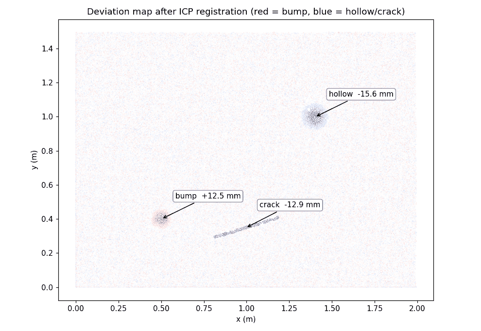
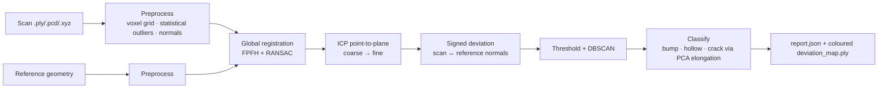

# Point-cloud surface-defect inspection (Open3D · ICP · DBSCAN · FastAPI)


Automatic quality control of built surfaces from 3D scans: the scan is cleaned, **registered to
the reference geometry (FPFH + RANSAC, then point-to-plane ICP)**, compared point by point, and
every deviation beyond a tolerance is clustered and classified as a **bump, hollow or crack**
with its depth, area and length. Available as a CLI, a Python library and a REST API.

> 🇫🇷 Contrôle qualité de surfaces à partir de scans 3D : nettoyage du nuage de points, recalage
> global + ICP sur la géométrie de référence, carte d'écarts, détection et classification des
> défauts (bosse, creux, fissure), API FastAPI conteneurisée et CI.



## Pipeline



Without a reference, the surface is assumed planar and a RANSAC plane is used instead.

## Results on the synthetic benchmark

A 2 m × 1.5 m wall inside a room corner (190 k points, 0.8 mm sensor noise), scanned from a
different pose (5° rotation, ≈ 6 cm translation), with 3 known defects:

| Defect | Ground truth | Detected |
|---|---|---|
| Bump | +12 mm, Ø 12 cm | bump, +12.5 mm |
| Hollow | −15 mm, Ø 16 cm | hollow, −15.6 mm |
| Crack | 40 cm long, −10 mm | crack, 39.8 cm, −12.9 mm |

Registration: fitness 0.998 · inlier RMSE ≈ 2.7 mm · full run ≈ 4.5 s on a laptop CPU
(≈ 0.5 s without registration). The same scenario runs in CI on every push and is summarised in
the job summary. Why a corner and not a flat wall? A single plane leaves ICP free to slide or
flip; real inspections register on richer geometry (corners, openings, BIM model).

## Usage

```bash
pip install -r requirements.txt

# demo on synthetic data
python -m pcd_inspect.cli demo --out output

# your own scans
python -m pcd_inspect.cli scan.ply --reference as_designed.ply --threshold-mm 5 --out output
```

Outputs: `output/report.json` (defects, registration quality, timing) and
`output/deviation_map.ply` (open it in MeshLab or CloudCompare).

### REST API

```bash
docker build -t pcd-inspect . && docker run -p 8000:8000 pcd-inspect
curl -F "scan=@scan.ply" -F "reference=@reference.ply" "http://localhost:8000/inspect?threshold_mm=4"
```

Example response: [examples/report_example.json](examples/report_example.json).

## Tests

```bash
pip install -r requirements-dev.txt
pytest -q
```

- outlier removal, normals
- defect detection and classification on a planar surface, no false positive on a clean wall
- registration recovers a known pose (< 0.5° and < 5 mm)
- end-to-end inspection with registration
- API upload, validation of formats

## Project structure

```
pcd_inspect/
  synthetic.py      walls/corners with known defects, rigid transforms
  preprocess.py     voxel grid, statistical outlier removal, normals
  registration.py   FPFH + RANSAC global registration, ICP refinement
  inspection.py     deviation (plane or reference), DBSCAN, classification, colour map
  pipeline.py       end-to-end + report export
  cli.py · api.py   command line and FastAPI service
tests/  examples/  Dockerfile  .github/workflows/ci.yml
```

## Background

Built on my industrial experience on a construction-site inspection robot (point-cloud
processing, ICP/NDT registration, real-time defect detection). This public version uses
synthetic data only.

## Author

**Asma Kerkouri** · DevOps & AI engineer · [LinkedIn](https://www.linkedin.com/in/asma-kerkouri-443b6815a)
